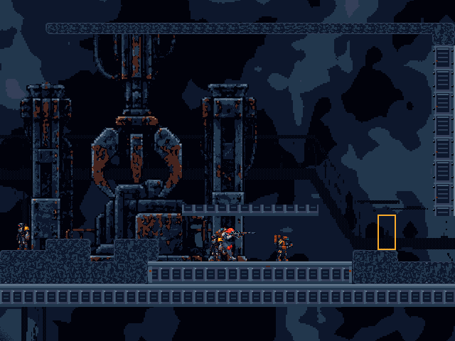
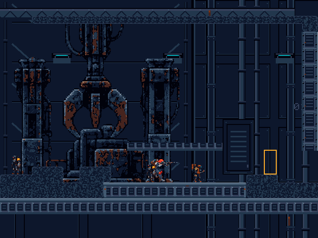

# Visual direction, phase 1: transfer bay

## Baseline and scope

Branch `codex/visual-direction-phase1` starts from fetched `origin/main`, commit
`a8b1649` (26 October 2026). The unrelated bot/floor changes on
`fix/m7-2-bot-support-and-floor-unification` are not part of this baseline.

The slice is the west entry / central salvage transfer bay in
`Assets/Scenes/Demo/SalvageIntake.unity`. The new wall occupies world
`x=-34..30`, `y=-16..32`. It is local architectural dressing, not a new level
layout or a global replacement of the parallax assets.

## Artistic diagnosis

The two large backdrop planes contain irregular dark masses, with contrasts
similar to the machinery. Their shapes read as camouflage rather than structure.
They show through the gaps in the crane, gantries, and floor supports, interrupting
the industrial silhouettes. Both the dark terrain atlas and detailed machinery
then compete for the same value range. Adding more small props would increase
this problem.

The existing gantry uprights, suspended handler, central housing, west bulkhead,
player body/weapon overlays, Sentry and Bombardier art, and reinforced solid
structural skins are worth keeping. They already establish the steel/cold-blue/
rust identity at the correct density. The industrial terrain atlas is noisy,
but its distinct damage language currently carries important breaching information.

Inspection covered the saved scenes, player/effect prefabs, sprite import settings,
visual and hidden collision Tilemaps, URP 2D renderer settings, default unlit
material, native-pixel/penumbra shaders, camera follow, sorting, HUD, and environment
authoring code. Ordinary world sprites use `Sprite-Unlit-Default`. There is one
sorting layer (`Default`), with ordering managed by sorting order. Native rendering
uses a world target and palette-resolved target. The HUD mixes a separate weapon
carousel with seven large status/tutorial text rows, which still look like a prototype.

## Rules adopted

| Concern | Phase 1 rule |
| --- | --- |
| Identity | Abandoned heavy salvage infrastructure; recognizable joints, bays, flanges, trusses, service recesses, and load paths. |
| Palette | Existing Canonical 28 only; binary alpha. Deep Navy for backing planes, Deep Space for bounded recesses, Shadow for structure, Steel Shadow for sparse edges. |
| Pixel density | 16 PPU, scale one, point filtering, no mipmaps/compression/resampling or fallback physics shapes. |
| Materials | Steel dominates; rust stays at a few joints. No random surface noise, all-over corrosion, or decorative rubble fill. |
| Hierarchy | Quiet wall, then detailed machinery, then crisp walking faces and combat silhouettes. Keep bright cyan/orange accents scarce. |
| Architecture | Large rectangular panels, repeated but spaced columns, pipe flanges, maintenance hatches, and a crane rail form one facility. |
| Depth | Existing far/depth planes at -30/-40; local wall at -24; machinery around -16..-10; existing structural skins and actors above them. |
| Geometry | Collision remains authoritative. No new ledges, platforms, physical gaps, or foreground covers over destructible tiles. Existing solid/damaged material distinction stays intact. |
| Lighting | Author cold fixture pixels and stepped plate illumination into the art. Keep the existing palette penumbra and readable central region. No new realtime lights, bloom, alpha fog, or exposure changes. |

## Implementation

- `Tools/EnvironmentArt/build_phase1_architecture.py` authors exact architectural
  pixels from the repository palette. Re-run with Python/Pillow already available
  in the environment; no new package or third-party art is added. It uses simple
  rectilinear geometry and a small authored stencil alphabet, not AI source imagery.
- `Assets/Art/Environment/TransferBay/transfer_service_wall.png` is a bounded
  1024×768 wall: panel bays, flanged pipes, a recessed crane well, overhead truss,
  fixtures, hatches, and subdued transfer signage. Original assets are untouched.
- `Assets/Editor/RustlineVisualDirectionSliceSetup.cs` applies one static sprite
  under `Art Dressing - Preserve`, updating it in place on reapplication. Its
  validation also invokes existing expansion, material-language and scene-order
  validators. It does not regenerate terrain or gameplay.
- `SalvageIntake.unity` adds only that GameObject/Transform/SpriteRenderer and its
  parent child-list entry. Existing scene IDs and GUID references are preserved.
- `Assets/Tests/PlayMode/VisualDirectionSlicePlayModeTests.cs` records equivalent
  real URP world/resolved targets. Existing canonical-art/import tests also cover
  the new asset.

The cost is one added SpriteRenderer with the existing material, a 3 MiB RGBA32
texture, and no new runtime scripts, cameras, render targets, lights, dependencies,
or per-frame logic. Draw calls and sustained GPU performance were not profiled.

## Visual evidence and validation

The images below are actual Unity 6000.4.0f1 / URP offscreen renders of the saved
scene, captured before and after from the same two camera positions. They are
unscaled 640×480 logical palette-resolved targets, with actors held and encounters
dormant. The requested batch screen dimensions do not override the Editor's
640×480 Game View. The world and resolved targets were both exported; at this
crop the scene falls inside the unchanged fully visible penumbra region.
The screen-space overlay HUD is excluded. These are not normal-window gameplay
screenshots or a human playtest, and they do not demonstrate active combat or
larger-viewport edge composition.

| View | Camera center | Held player root | Before | After |
| --- | --- | --- | --- | --- |
| West entry | (-14, 8) | (-14, 1) | [Before](reference/visual-direction-phase1/entry-before.png) | [After](reference/visual-direction-phase1/entry-after.png) |
| Transfer bay | (8, 8) | (8, 0) | [Before](reference/visual-direction-phase1/bay-before.png) | [After](reference/visual-direction-phase1/bay-after.png) |

Visual inspection: the backdrop now reads as a service wall and crane well, with
quieter backing planes between the machinery silhouettes. Pipe runs and cold
fixtures tie the bay together. Existing walking faces and enemies stand out more
clearly against the wall. The terrain texture and repeated floor skins remain
conspicuous; those are specific next-pass art problems, not validation failures.

Automated results:

- Full Play Mode suite: **110/110 passed**, including movement, combat, enemy
  presentation, camera/native-pixel rendering, breaching, and supported spawn.
- Environment palette audit: **41 PNGs**, zero off-palette opaque pixels and zero
  partial-alpha pixels. The new wall is also checked at generation time and by
  the existing native-import/canonical-pixel Edit Mode test.
- `python Tools/EnvironmentArt/validate_scene_preservation.py a8b1649`: **114
  protected component/map blocks unchanged**. Ground collision retains 890 cells
  (SHA-256 `682e2f083f1f563383aa4aa3b547519e7f265166d8517fbbe44f6e01354e568e`);
  maintenance precision collision retains 6 cells
  (`328ffd3ad0ddf78bb8d21da54bfdff61d2201acd2161c64b09bd43fbfd5396be`).
- Full Edit Mode suite: **427/427 passed**, including the new wall's canonical
  pixel/import test and the existing production-regeneration/collision tests.
- `RustlineVisualDirectionSliceSetup.Validate`: **passed**, including the original
  environment material distinction, expansion scene, and build-scene-order
  validators.
- Existing `RustlineFirstPlayableSetup.BuildWindowsRelease`: **passed**, normal
  non-development Windows x64 Release, with the original build collision guard.
- With Unity closed, existing standalone smoke: **exit 0 / FIRST_PLAYABLE_SMOKE_PASS**.
  Actual input traversed the real floor and original/extension seam, jumped and
  landed, and completed all seven staged hitscan encounters, checkpoint/retry,
  extraction, and restart. Ground Composite: **4 paths / 78 points**; precision
  ceiling Composite: **1 path / 4 points**. This automated staging does not
  replace human traversal, combat balance, or a normal-window visual review.
- `git diff --check`: **passed**. Unity's unrelated line-ending-only changes in
  project settings/build order and the existing RuleTile were discarded.

Local execution records: `Logs/VisualDirectionPhase1/editmode.xml`,
`Logs/VisualDirectionPhase1/playmode.xml`, `Logs/visual-phase1-validate.log`,
`Logs/visual-phase1-release-build.log`, and `Logs/visual-phase1-release-smoke.log`.
These logs/builds stay in the repository's ignored output folders. The four
comparison PNGs above are retained with this report.

Reproduce the captures with Unity `-batchmode -projectPath <repo> -runTests
-testPlatform PlayMode -testFilter Rustline.Tests.VisualDirectionSlicePlayModeTests
-testResults Logs/VisualDirectionPhase1/capture-tests.xml -logFile
Logs/visual-phase1-capture.log`. Outputs are under
`Logs/VisualDirectionPhase1/after` by default; set `RUSTLINE_VISUAL_PHASE=before`
in the editor process environment for a baseline run. Load the baseline scene
from `a8b1649` in an isolated checkout to recreate the before images; do not
overwrite local scene work. Use the existing production commands for regeneration;
the new preserved dressing root survives that rebuild.

## Remaining work

The rest of the route still exposes the old abstract backdrops. The new wall is
deliberately bounded; larger viewports can show its transition to the unfinished
shaft/upper areas. Extract reusable wall/pipe/fixture modules before extending
this language elsewhere, rather than duplicating the full wall texture.

The destructible terrain still has dense texture, some permanent floor skins
repeat like cabinets, and machinery and enemies share rust accents. Next, design
a quieter destructible steel tile family while preserving every connectivity and
breaching rule; then inspect enemy silhouettes in active combat, the shaft
transition, and larger viewport compositions. A compact health/objective HUD
with tutorial information moved out of the persistent status stack is a separate
presentation iteration. No HUD behavior was changed in this phase.
