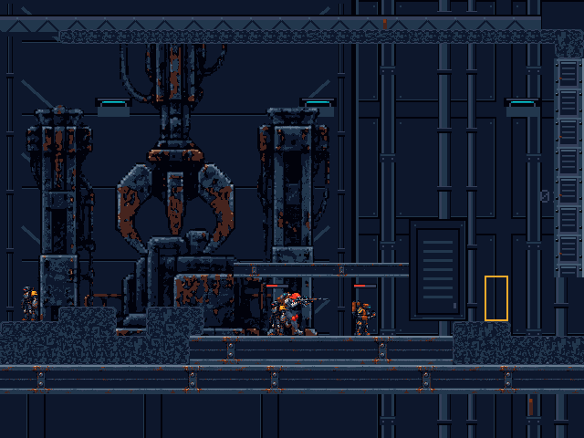

# Visual refinement, phase 2

## Scope and preserved work

Work continues on `codex/visual-refinement-phase2`, retaining the complete local
Phase 1 work from `codex/visual-direction-phase1`. That work was based on main
`a8b1649`; it did not include the later beam commits on
`fix/m7-2-bot-support-and-floor-unification`. This explains the missing beam
flooring in the Phase 1 result.

The steel service wall, pipe runs, crane well, fixtures, native scale, palette,
and machinery placement are preserved. This iteration restores existing floor
art and adds presentation to the existing enemies. It does not import the
separate bot physics changes from the historical floor branch.

## Restored indestructible beam flooring

The exact reviewed production PNGs and their original `.meta` files were
recovered from `049dc63` (original asset introduction: `b7c3a27`):

- `Assets/Art/Environment/Hardening/reinforced_floor_ibeam_deep.png`, 256×32.
- `Assets/Art/Environment/Hardening/reinforced_floor_ibeam_shallow.png`, 128×16.

Their GUIDs, sprite IDs, native 16 PPU imports, opaque joins, and canonical
steel/rust pixels are retained. No new generated art or dependency was needed.

| Existing indestructible span | Bounds in world units | Restored art |
| --- | --- | --- |
| Lower bay floor | x=1..19, y=-2..0 | Deep I-beam |
| Lower safety floor | x=-28..34, y=-4..-2 | Deep I-beam |
| Transfer catwalk left | x=4..10, y=4..5 | Shallow I-beam |
| Transfer catwalk right | x=10..16, y=4..5 | Shallow I-beam |
| Maintenance precision passage roof | x=102..108, y=19.625..20.625 | Shallow I-beam |

Continuous horizontal flanges replace the repeated cabinet modules and make
permanent floors read as structural steel. Walking edges and the maintenance
passage retain their exact bounds. Shafts retain their existing vertical art.
The industrial terrain atlas continues to mark destructible surfaces; no
decorative covers are placed over destructible cells.

The narrow floor action migrates only the owned floor modules and updates the
five spans. Full environment regeneration also retains the beams. The legacy
catwalk clearance tool recognizes the shallow beam's original height.

## Enemy health bars

`EnemyHealthBar2D` is attached to the fourteen existing production enemies,
including both Sentry and Bombardier. It reads existing health events and AI
states; it does not modify health, targeting, movement, damage, or encounter state.

- A **26×5 source-pixel** bar has a Deep Space backing, neutral Steel Shadow
  well, and **24×2 px** red health fill. No names, numbers, levels, or icons.
- Detection/alert/pursuit/attack states show a full bar; actual damage also shows
  it. Undetected patrol and dormant encounters remain quiet.
- The bar hides **2.5 seconds** after the last engagement/damage activity. It
  hides immediately on death or reset. It hides rather than alpha-fading, keeping
  canonical colors intact. Pausing preserves the gameplay-time timeout.
- A fixed anchor 52 source pixels above the root clears the authored living
  poses without following changing sprite bounds. Position is snapped to 1/16 u
  in LateUpdate after camera/animation updates. A sibling under the static
  encounter root avoids inheriting unsnapped physics motion. Facing never mirrors
  the health fill.
- Fill width changes in whole pixels only on damage/reset, with at least one
  filled pixel while alive. Rendering uses three small SpriteRenderers per bar,
  one shared sprite over Unity's existing white texture, and the existing unlit
  material. Hidden bars disable all three renderers. No added Canvas, camera,
  render texture, texture allocation, raycast, scene scan per frame, or material
  instance. Draw calls/frame timing were not profiled.
- Presentation is part of the existing world render, so the normal penumbra and
  darkness also affect the bars. It creates no HUD information outside that mask.

The initial mesh-based attempt was rejected by the rendered test because it
produced no visible bar pixels in the 2D pipeline. The final sprite path passes
the rendered pixel checks. No extra shader was introduced.

## Main files changed in this phase

| File | Purpose |
| --- | --- |
| `Assets/Scenes/Demo/SalvageIntake.unity` | Restore floor skins; attach fourteen enemy presentation components. |
| `Assets/Art/Environment/Hardening/reinforced_floor_ibeam_*.png` and `.meta` | Restore exact historical artwork and GUIDs. |
| `Assets/Editor/RustlineEnvironmentVisualHardeningSetup.cs` | Restore beam migration, narrow application, regeneration, and validation. |
| `Assets/Editor/RustlineSalvageIntakeCatwalkClearanceSetup.cs` | Recognize the restored horizontal catwalk skin. |
| `Assets/Scripts/Presentation/EnemyHealthBar2D.cs` | Conditional visibility, event-driven fill, and snapped tracking. |
| `Assets/Editor/RustlineVisualRefinementSetup.cs` | Apply and validate the iteration without rebuilding gameplay. |
| `Assets/Editor/RustlineFirstPlayableSetup.cs` | Two factory calls retain health bars when production enemies are regenerated. |
| `Assets/Tests/PlayMode/EnemyHealthBarPlayModeTests.cs` | Both enemy types, lifecycle, real detection, tracking, and rendered health pixels. |
| `Assets/Tests/EditMode/EnvironmentVisualHardeningTests.cs` | Native beam imports/bounds and full regeneration preserve the refinement. |
| `Tools/EnvironmentArt/validate_scene_preservation.py` | Explicit opt-in for only fourteen added bar presenters; existing protected components must remain identical. |

## Rendered evidence and validation

The retained images are actual Unity 6000.4.0f1 / URP palette-resolved targets at
**640×480**, camera center **(8,8)** and player root **(8,0)**. The before image is
the delivered Phase 1 view; the two new views use the same camera. Actors are
held to isolate presentation, with real health damage applied for the bar view.
The overlay status HUD is excluded. These are offscreen scene renders, not
normal-window screenshots or a human combat playtest.

| Comparison | Image |
| --- | --- |
| Phase 1 floor treatment | [Before](reference/visual-refinement-phase2/bay-before.png) |
| Restored beams; dormant bars hidden | [Quiet view](reference/visual-refinement-phase2/bay-quiet.png) |
| Restored beams; two half-health enemies | [Damage view](reference/visual-refinement-phase2/bay-damaged.png) |

Inspected the quiet/damaged renders at native scale. The continuous flanges and
broader beam web remove cabinet-like repetition, while the new bars provide
clear enemy/health cues without adding permanent interface clutter. The service
wall, pipes, crane well, gantries, and housing retain their previous placement
and art. No replacement backdrop was generated.

Automated validation:

- Full Play Mode: **113/113 passed**, including the existing movement, combat,
  breaching, presentation, camera, and progression cases and three new health-bar
  cases. The final focused run also passed **3/3**, including an added assertion
  that a currently visible bar hides immediately on death.
- Full Edit Mode: **432/432 passed**, including beam imports/native bounds and
  full production regeneration retaining the background and all fourteen bars.
- The rendered test verifies that both half-health bars actually contribute
  pixels, that all changed bar pixels are canonical, and that their combined
  health fill contains exactly **48 red pixels** (two 12×2 strips).
- Environment palette audit: **43 PNGs**, zero off-palette opaque pixels and zero
  partial-alpha pixels. Restored PNG and meta bytes match `049dc63` exactly.
- Preservation check against `a8b1649`, with explicit `--allow-enemy-health-bars`:
  **114 existing protected component/map blocks unchanged**, exactly fourteen
  new bar presenters permitted. Ground retains **890 cells** and maintenance
  precision collision **6 cells**, with the accepted hashes unchanged.
- Comparing saved scene blocks to the local Phase 1 baseline finds only three
  modified existing SpriteRenderers (the two catwalks and maintenance roof),
  three parent child-lists, and fourteen enemy component-lists. Old floor modules
  are replaced by the two unified floor beams. All existing gameplay components,
  background/machinery renderers, camera records, and physical geometry remain
  identical.

- Explicit `RustlineVisualRefinementSetup.Validate`: **passed**, including the
  original production scene validators and the Phase 1 background contract.
- **Release build succeeded**: existing
  `RustlineFirstPlayableSetup.BuildWindowsRelease`, normal non-development
  Windows x64, with the unchanged release-critical Composite build guard.
  Executable: `Builds/FirstPlayable/Rustline.exe`.
- With Unity closed, standalone Release smoke: **exit 0 /
  FIRST_PLAYABLE_SMOKE_PASS**. Actual Tilemap support, keyboard traversal,
  jump/landing, original-to-extension seam, all seven staged hitscan encounters,
  checkpoints, retries, extraction, and restart passed. Ground Composite:
  **4 paths / 78 points**; precision ceiling: **1 path / 4 points**.
  The existing URP shutdown ComputeBuffer disposal warning remains non-blocking.
- `git diff --check`: **passed**. Unrelated EOL-only changes left by Unity in
  project settings, build order, and the existing RuleTile were discarded.

Local logs/results are under `Logs/VisualRefinementPhase2/` and
`Logs/visual-phase2-*.log`; retained comparison PNGs are linked above. Reproduce
the health-bar render/behavior checks with Unity `-batchmode -projectPath <repo>
-runTests -testPlatform PlayMode -testFilter Rustline.Tests.EnemyHealthBarPlayModeTests
-testResults Logs/VisualRefinementPhase2/health-bars.xml -logFile
Logs/visual-phase2-health-bars.log`. The editor commands are **Tools > Rustline >
Visual Direction > Apply Phase 2 Refinement / Validate Phase 2 Refinement**.

## Remaining issues and next refinement

The restored beams and quiet background improve the separation of permanent
structure, machinery, and actors. The destructible atlas still looks noisy and
remains the main environment-art inconsistency. A quieter damaged-steel tile
family should preserve all current connectivity, collision, and breach behavior.

The bounded service-wall transition to unfinished areas and larger viewport
composition still need a separate pass. Player/enemy rust accents can overlap
against the central housing during combat; a future authored character material
pass should be judged in motion. The main status/tutorial HUD remains unchanged.
Human combat readability, 1×/2× display acceptance, and sustained GPU/frame-time
profiling remain manual checks. This iteration stops at the restored slice and
conditional health bars; no PR or merge is created.
